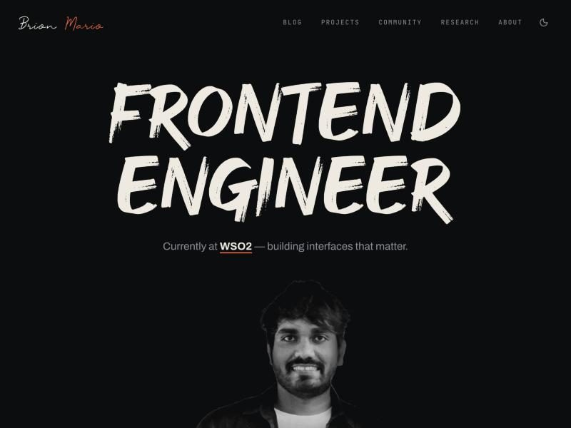
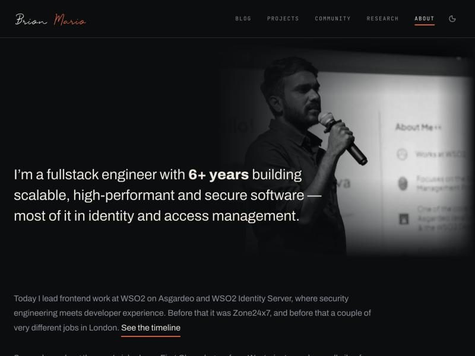
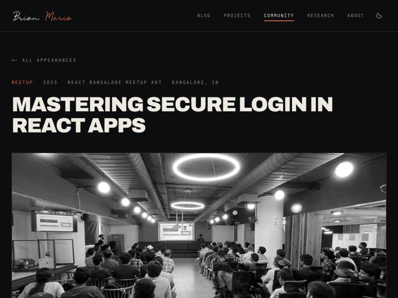

<div align="center">


**[brionmario.com](https://brionmario.com)** — personal site. Blog, projects, talks and research.

</div>

---

## What's here

A Turborepo monorepo with one Next.js app and a shared UI package.

```
apps/web            the site
packages/ui         shared components, Tailwind theme, global styles
packages/eslint-config
packages/typescript-config
```

| Route                           | What it is                                                |
| ------------------------------- | --------------------------------------------------------- |
| `/`                             | Landing page                                              |
| `/blog`, `/blog/[slug]`         | Posts, imported from Medium as Markdown                   |
| `/projects`                     | Open source and side projects                             |
| `/community`, `/community/[id]` | Talks, workshops and judging panels, with photo galleries |
| `/research`, `/research/[id]`   | Published papers                                          |
| `/about`                        | Bio, career timeline and a world map of where I've been   |

## Screenshots

<table>
<tr>
<td width="33%"></td>
<td width="33%"></td>
<td width="33%"></td>
</tr>
<tr>
<td align="center"><sub>Home</sub></td>
<td align="center"><sub>About</sub></td>
<td align="center"><sub>Talk detail</sub></td>
</tr>
</table>

## Stack

Next.js 16 (App Router, Turbopack) · React 19 · TypeScript · Tailwind CSS v4 · Turborepo · pnpm

`d3-geo` and `topojson` draw the travel map, and `gray-matter` plus `react-markdown` render the blog. Animations are plain CSS transitions driven by an `IntersectionObserver`, so there's no animation library in the bundle.

## Running it

Requires Node 20+ and pnpm 9.

```bash
pnpm install
pnpm dev
```

The site runs at <http://localhost:3000>.

| Command          | What it does                        |
| ---------------- | ----------------------------------- |
| `pnpm dev`       | Dev server, Turbopack               |
| `pnpm build`     | Production build                    |
| `pnpm lint`      | ESLint across the workspace         |
| `pnpm typecheck` | `tsc --noEmit` across the workspace |
| `pnpm format`    | Prettier                            |

## Content

Content lives on disk — there is no CMS.

- **Blog posts** are Markdown at `apps/web/content/blog/<slug>/index.md`, generated from a Medium export by [medmark](https://github.com/brionmario/medmark) using `apps/web/scripts/medmark-template.cjs`.
- **Talks, projects, research and the travel map** are typed arrays in `apps/web/lib/data/`.
- **Images** live in `apps/web/public/images/`, by category.
- **GitHub projects** are generated into `apps/web/lib/data/autogen/` by `pnpm dataseed` (run from `apps/web`), which picks up public repos tagged `featured-project` or `portfolio`.

There's a Claude Code skill at `.claude/skills/update-site-data` that walks through each of these — importing a Medium export, swapping the embedded Instagram reels, adding trip photos and re-running the project seeder.

## Deployment

Pushes to `main` deploy to Vercel.

## License

No license file yet, so default copyright applies and all rights are reserved. If you want the source to be reusable, add a `LICENSE` — note that the written content, photographs and brand assets would usually be carved out of it.
